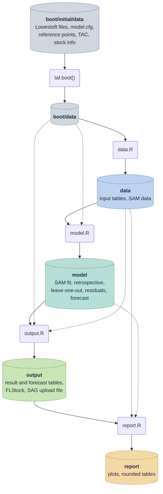
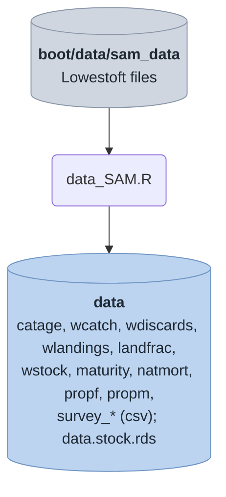
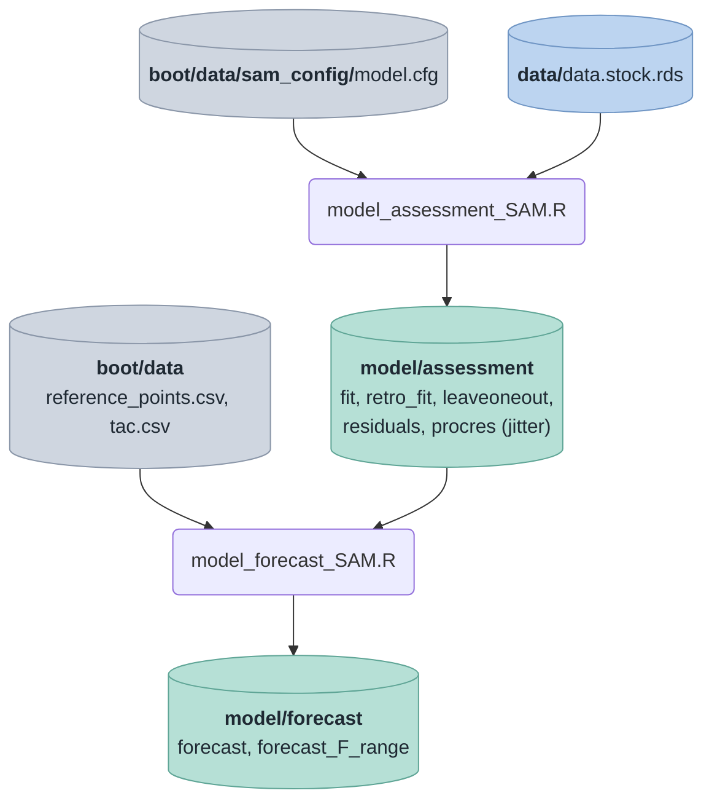
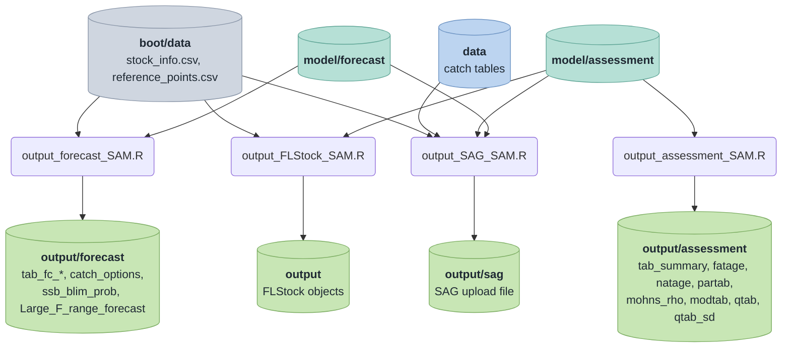
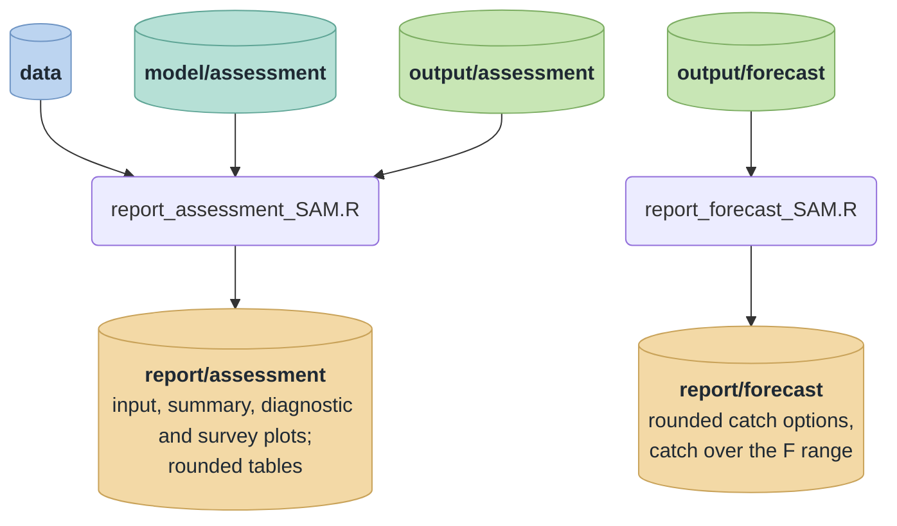

# TAF template for a SAM assessment

## note to developers
before modifying these scripts please install or update the packages they
use, as shown under Running below.

This is a template for a Stock Assessment Model (SAM) assessment using the TAF (Transparent Assessment Framework). It provides a structured approach to conducting stock assessments, ensuring transparency and reproducibility.

## Flow



Cylinders are data (folder names in bold), rounded boxes are the steps that
read and write them.
Solid arrows: the main flow. Dashed arrows: a step also reads an earlier folder.
Data only flow forwards.

## Running

```r
library(TAF)
install.packages(deps(installed = FALSE),
                 repos = c("https://fishfollower.r-universe.dev",
                           "https://ices-tools-prod.r-universe.dev",
                           "https://flr.r-universe.dev",
                           "https://cloud.r-project.org"))
taf.boot()
source.all()
```

This installs the R packages that the scripts use and that are missing, from
CRAN or the r-universes above. Run it in an assessment made from the
template, after removing the scripts it does not use.

## Software

- stockassessment 0.12.1 (2026-10-30), from
  <https://fishfollower.r-universe.dev>. Nielsen A, Berg CW (2014). Estimation
  of time-varying selectivity in stock assessments using state-space models.
  Fisheries Research 158: 96-101. <https://doi.org/10.1016/j.fishres.2014.01.014>

## Details

Each step runs its own scripts (rounded boxes), which read data (cylinders)
and write the next folder.

### data.R



### model.R



### output.R



### report.R


